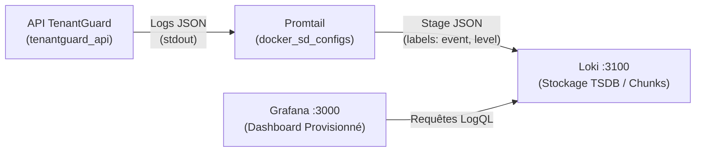

# Observabilité & Surveillance Sécurité — TenantGuard 📊

Ce document décrit l'architecture d'observabilité de TenantGuard, basée sur **Loki**, **Promtail** et **Grafana**, pour la centralisation, l'indexation et la visualisation des flux d'audit de sécurité.

---

## 🏗️ Architecture d'Observabilité



- **API TenantGuard (`tenantguard_api`)** : émet chaque événement d'audit de sécurité en JSON structuré sur une seule ligne sur `stdout` via le logger dédié `tenantguard.audit`.
- **Promtail (`tenantguard_promtail`)** : découvre dynamiquement le conteneur `tenantguard_api` via l'API Docker (`docker_sd_configs`), extrait et labellise les métadonnées (`event`, `level`), et pousse vers Loki.
- **Loki (`tenantguard_loki`)** : stocke et indexe les streams de logs sur le système de fichiers local (`/loki`).
- **Grafana (`tenantguard_grafana`)** : expose l'interface visuelle sur le port `3000`, avec provisionnement automatique de la source de données Loki et du tableau de bord d'audit sécurité.

---

## ⚡ Démarrage de la Stack

Les services d'observabilité sont isolés dans un fichier Compose dédié (`docker-compose.observability.yml`) afin de ne pas ralentir ni impacter l'environnement de développement standard et les pipelines CI/CD (DAST), qui n'ont pas besoin de définir de variables d'observabilité.

### 1. Démarrer toute la stack (App + Observabilité)

Avant de lancer la stack d'observabilité, définissez la variable `GRAFANA_ADMIN_PASSWORD` dans votre fichier `.env` (générez un mot de passe fort avec `openssl rand -base64 24`). Si cette variable n'est pas définie, le démarrage échouera pour des raisons de sécurité.

```bash
docker compose -f docker-compose.yml -f docker-compose.observability.yml up -d --build
```

### 2. Démarrer uniquement l'application et la base (Mode CI / DAST standard)

```bash
docker compose up -d
```

> [!NOTE]
> `docker compose up` démarre exclusivement `tenantguard_db` et `tenantguard_api` sans nécessiter de configuration Grafana.

---

## 🖥️ Accès à Grafana & Sécurisation Réseau

> [!IMPORTANT]
> **Durcissement réseau (Localhost Only) :**  
> Les ports de **Grafana (`127.0.0.1:3000`)** et de **Loki (`127.0.0.1:3100`)** sont strictement liés à l'interface locale (`127.0.0.1`). Ils ne sont pas exposés sur `0.0.0.0` ni accessibles depuis l'extérieur de la machine hôte.

| Service | URL | Identifiants |
| :--- | :--- | :--- |
| **Grafana** | [http://127.0.0.1:3000](http://127.0.0.1:3000) | Utilisateur : `${GRAFANA_ADMIN_USER}` (`admin` par défaut)<br>Mot de passe : `${GRAFANA_ADMIN_PASSWORD}` (défini dans `.env`) |
| **Loki** | [http://127.0.0.1:3100](http://127.0.0.1:3100) | Interne / proxyisé (API Push/Query sur `127.0.0.1`) |

Le dashboard de départ est automatiquement provisionné dans le dossier **TenantGuard** :
- **Titre du Dashboard :** `TenantGuard - Audit & Observabilité Sécurité`
- **UID :** `tenantguard-security-overview`
- **Panels inclus :**
  1. **Volume des événements par type dans le temps** (Time series / diagramme en barres empilées)
  2. **Tentatives de Connexion Échouées (`AUTH_LOGIN_FAILED`)** (Tableau des logs récents avec utilisateur et IP)
  3. **Refus d'Accès Inter-Tenant (`DOCUMENT_ACCESS_DENIED`)** (Tableau de détection des tentatives IDOR)
  4. **Activité & Requêtes RAG (`RAG_QUERY`)** (Historique des requêtes RAG et chunks extraits)

---

## 🔍 Exemples de Requêtes LogQL

Dans l'onglet **Explore** de Grafana (ou au sein des panels), vous pouvez interroger les logs à l'aide de LogQL :

### 1. Filtrer les échecs d'authentification et extraire les champs JSON
```logql
{container="tenantguard_api"} | json | event="AUTH_LOGIN_FAILED"
```

### 2. Détecter les tentatives d'accès non autorisées (IDOR inter-tenant)
```logql
{container="tenantguard_api"} | json | event="DOCUMENT_ACCESS_DENIED"
```

### 3. Calculer le taux d'événements par type par minute (Graphique)
```logql
sum by (event) (count_over_time({container="tenantguard_api"} | json | event != "" [1m]))
```

### 4. Filtrer les requêtes RAG posées par un utilisateur ou tenant spécifique
```logql
{container="tenantguard_api"} | json | event="RAG_QUERY" | user_tenant=1
```

### 5. Rechercher toutes les alertes de sécurité (niveau WARNING)
```logql
{container="tenantguard_api", level="WARNING"} | json
```

---

## 🛑 Arrêt des Services

Pour arrêter l'ensemble des conteneurs :

```bash
docker compose -f docker-compose.yml -f docker-compose.observability.yml down
```

---

## 🔒 Security Notes

1. **Montage `/var/run/docker.sock` par Promtail (read-only)** : Bien que monté en lecture seule (`:ro`), ce socket expose les métadonnées de l'ensemble des conteneurs et les journaux du démon Docker de l'hôte. Ce mécanisme est acceptable uniquement dans le cadre d'un profil de démonstration locale ; la production doit privilégier un log driver (ex. Loki Docker Driver) ou un scraping basé sur des fichiers (`file-based scrape`).
2. **Origine du champ `ip` dans les logs d'audit** : Le champ `ip` provient directement de `request.client.host`. Derrière un reverse proxy, il correspond à l'adresse du proxy et non à celle du client réel. La production exige `uvicorn --proxy-headers` restreint via `--forwarded-allow-ips` (ou un traitement de confiance équivalent de `X-Forwarded-For`), cet en-tête ne devant jamais être accepté inconditionnellement.
