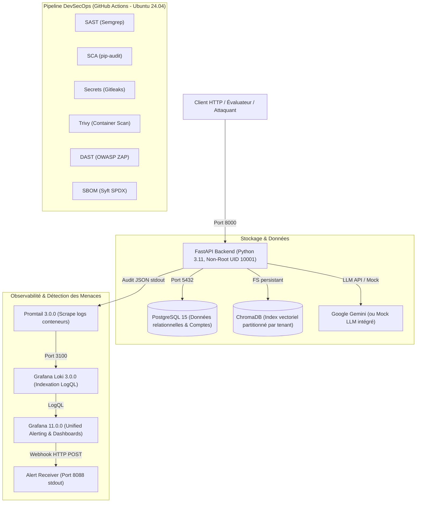

# TenantGuard 🛡️ — Architecture SaaS Multi-Tenant RAG Sécurisée avec Observabilité et Détection des Menaces (v1.0)

[](https://github.com/h-4mza/TenantGuard/actions/workflows/devsecops.yml)
[](https://github.com/h-4mza/TenantGuard/releases)
[](https://www.python.org/)
[](https://fastapi.tiangolo.com/)
[](https://www.trychroma.com/)
[](https://www.postgresql.org/)
[](https://grafana.com/)
[](LICENSE)

> [!WARNING]
> **Avertissement — Projet Éducatif & Historique d'Audit :**  
> Ce dépôt est un projet éducatif et un cas d'étude technique. La version initiale (v0), délibérément vulnérable, ainsi que l'ensemble des preuves de concept issues du pentest initial restent conservées dans l'historique Git et dans le dossier [`pentest/`](pentest/) à des fins didactiques et de traçabilité. Ne déployez pas ce code tel quel dans un environnement de production réel.

> [!NOTE]
> **Cas d'étude technique & Portfolio :**  
> **TenantGuard** illustre le cycle de vie complet de sécurisation d'une application SaaS multi-tenant intégrant un pipeline RAG (*Retrieval-Augmented Generation*).  
> À partir d'une version initiale délibérément vulnérable (v0), la plateforme a fait l'objet d'un audit offensif documenté ([`pentest/report.md`](pentest/report.md)), d'une remédiation intégrale de son code applicatif (v1.0), de la mise en place d'un pipeline DevSecOps à gates bloquantes, d'une stack d'observabilité et d'audit structuré (Loki/Promtail), de 7 règles de détection provisionnées en code (Grafana Unified Alerting mappées à MITRE ATT&CK), et d'une simulation d'incident avec calcul du MTTD (46,5 secondes) et post-mortem blameless.  
> 
> Pour une synthèse complète conçue pour recruteurs et évaluateurs, consultez l'**[Étude de Cas Technique (PORTFOLIO.md)](docs/PORTFOLIO.md)** ainsi que la **[Synthèse Exécutive de Sécurité (PDF)](docs/TenantGuard_Security_Summary.pdf)**.

---

## 🏗️ Architecture Globale du Système



---

## 🚀 Démarrage Rapide

### 1. Prérequis
- [Docker Engine](https://docs.docker.com/engine/) (version 24+) et [Docker Compose](https://docs.docker.com/compose/) (version v2+).
- `curl` et `bash` (pour l'exécution des scripts de démonstration et de vérification).

### 2. Configuration des variables d'environnement (`.env`)
Copiez le modèle de configuration et définissez les secrets requis :
```bash
cp .env.example .env
```
Générez des clés cryptographiquement fortes (l'API refuse de démarrer si `JWT_SECRET` fait moins de 32 caractères) :
```bash
# Générer un secret JWT 256 bits et un mot de passe Postgres
export JWT_SECRET=$(openssl rand -hex 32)
export POSTGRES_PASSWORD=$(openssl rand -hex 16)
export GRAFANA_ADMIN_PASSWORD=$(openssl rand -base64 18)

# Renseigner dans le fichier .env
sed -i "s|^JWT_SECRET=.*|JWT_SECRET=${JWT_SECRET}|" .env
sed -i "s|^POSTGRES_PASSWORD=.*|POSTGRES_PASSWORD=${POSTGRES_PASSWORD}|" .env
sed -i "s|^GRAFANA_ADMIN_PASSWORD=.*|GRAFANA_ADMIN_PASSWORD=${GRAFANA_ADMIN_PASSWORD}|" .env
```

### 3. Lancement de la stack complète (Applicatif + Observabilité)
```bash
docker compose -f docker-compose.yml -f docker-compose.observability.yml up -d --build
```

### 4. Accès aux interfaces et services
- **API FastAPI (Swagger UI)** : [http://localhost:8000/docs](http://localhost:8000/docs)
- **API Healthcheck** : [http://localhost:8000/health](http://localhost:8000/health)
- **Dashboard Grafana (Détection & Alertes)** : [http://127.0.0.1:3000](http://127.0.0.1:3000)  
  *(Identifiants : `admin` / valeur définie dans `GRAFANA_ADMIN_PASSWORD`)*
- **API Loki (LogQL)** : [http://127.0.0.1:3100](http://127.0.0.1:3100)
- **Récepteur Webhook d'Alertes** : [http://127.0.0.1:8088](http://127.0.0.1:8088)

---

## 🔑 Comptes de Démonstration (Seed Initial)

Au premier démarrage, la base de données PostgreSQL et ChromaDB sont automatiquement initialisées avec **3 tenants** et **3 utilisateurs pré-configurés** :

| Tenant ID | Organisation | Identifiant (Username) | Mot de passe de démo | Rôle | Cas d'usage de test |
|:---:|---|---|---|:---:|---|
| **1** | Acme Corp | `alice` | `alice123` | `admin` | Compte cible pour le brute force, la prise de contrôle (ATO) et l'exfiltration |
| **2** | CyberDyne Systems | `bob` | `bob123` | `admin` | Tenant victime pour les tests d'accès cross-tenant (IDOR/BOLA) |
| **3** | Initech | `charlie` | `charlie123` | `user` | Utilisateur standard pour tester les restrictions de privilèges et uploads |

> [!TIP]
> Ces mots de passe sont réservés aux démonstrations locales et aux scripts automatisés. Les scripts de test exigent leur transmission explicite par variables d'environnement (`ALICE_PASSWORD`, `BOB_PASSWORD`, `CHARLIE_PASSWORD`).

---

## 🛡️ Matrice des Vulnérabilités & Remédiations (v0 → v1.0)

L'ensemble des 8 vulnérabilités relevées lors du pentest de la v0 a été neutralisé dans la v1.0 :

| Finding | Titre du Finding | Statut v1.0 | Mécanisme de Remédiation | Test Associé | Règle de Détection Grafana |
|:---:|---|:---:|---|---|:---:|
| **FINDING-01** | Weak JWT Secret | **Corrigé** | Validation stricte au démarrage (min. 32 caractères, entropie 256 bits). | `test_jwt_secret_enforced` | `BRUTE_FORCE_LOGIN` / `ACCOUNT_TAKEOVER_SUSPECT` |
| **FINDING-02** | JWT No Expiration | **Corrigé** | Vérification stricte `verify_exp: True`, rejet HTTP 401 sur token expiré. | `test_expired_jwt_rejected` | `TOKEN_ABUSE` |
| **FINDING-03** | Cross-Tenant Document IDOR | **Corrigé** | Filtrage obligatoire sur `current_user.tenant_id`, retour HTTP 404 neutre. | `test_get_document_cross_tenant_forbidden_404` | `CROSS_TENANT_ACCESS` |
| **FINDING-04** | Cross-Tenant Upload Assignment | **Corrigé** | Assignation automatique et immuable au tenant de l'utilisateur connecté. | `test_upload_document_isolated_to_own_tenant` | `UPLOAD_ABUSE` |
| **FINDING-05** | Insecure Upload & Path Traversal | **Corrigé** | Assainissement `os.path.basename`, stockage sous UUID, whitelist d'extensions, limite 10 Mo. | `test_path_traversal_filename_sanitized` | `UPLOAD_ABUSE` |
| **FINDING-06** | RAG Cross-Tenant Leakage | **Corrigé** | Filtre ChromaDB `where={"tenant_id": ...}` forcé et non surchargeable. | `test_rag_strict_tenant_isolation` | `CROSS_TENANT_ACCESS` / `EXFILTRATION_VOLUME` |
| **FINDING-07** | RAG Prompt Injection | **Corrigé** | Délimiteurs XML/Markdown stricts et instructions système fermées. | `test_rag_delimiter_protection` | `EXFILTRATION_VOLUME` |
| **FINDING-08** | Hardcoded Secrets in Config | **Corrigé** | Élimination des fallbacks dans le code et Compose, gate CI Gitleaks, acceptation documentée. | CI Job `Secrets (Gitleaks)` | N/A (Prévention CI/CD + Baseline) |

Pour l'analyse détaillée des vulnérabilités et les limites d'architecture :  
👉 **Consultez [KNOWN_ISSUES_V0.md](KNOWN_ISSUES_V0.md)**.

---

## 🚨 Détection des Menaces & Réponse à Incident

TenantGuard intègre une détection en temps réel basée sur Grafana Unified Alerting et le moteur de requêtes LogQL :
- **7 règles d'alerte provisionnées en code** : Définies dans `config/grafana/provisioning/alerting/rules.yml`, mappées aux techniques MITRE ATT&CK (`T1110`, `T1110.004`, `T1078`, `T1190`, `T1105`, `T1528`, `T1530`).
- **Tableau de bord de surveillance** : Vue d'ensemble pré-provisionnée `tenantguard-detection-overview`.
- **Runbooks opérationnels** : Procédures de triage et d'escalade pas-à-pas documentées dans [`docs/runbooks/`](docs/runbooks/).
- **Simulation d'incident & Post-Mortem** : Scénario d'intrusion en 4 phases chronologiques ([`scripts/run_incident.sh`](scripts/run_incident.sh)), investigation médico-légale LogQL ([`docs/incident/INVESTIGATION.md`](docs/incident/INVESTIGATION.md)), preuves de confinement réelles ([`docs/incident/CONTAINMENT_EVIDENCE.md`](docs/incident/CONTAINMENT_EVIDENCE.md)) et post-mortem blameless avec MTTD mesuré à **46,5 secondes** ([`docs/incident/POSTMORTEM.md`](docs/incident/POSTMORTEM.md)).

Pour les détails des règles et requêtes LogQL :  
👉 **Consultez [DETECTION.md](DETECTION.md)** et **[OBSERVABILITY.md](OBSERVABILITY.md)**.

---

## 🎬 Démonstration Autonome en Une Seule Commande

Pour évaluer la plateforme en conditions réelles, exécutez le script de démonstration autonome :

```bash
ALICE_PASSWORD=alice123 BOB_PASSWORD=bob123 CHARLIE_PASSWORD=charlie123 \
GRAFANA_ADMIN_PASSWORD=<votre-mot-de-passe-grafana> \
bash scripts/demo.sh
```

Ce script vérifie la santé des conteneurs, rejoue 3 scénarios d'attaque représentatifs (brute-force, accès cross-tenant et jeton expiré), interroge le récepteur d'alertes webhook pour afficher les alertes reçues, et fournit les liens directs d'investigation Grafana.

---

## 🧪 Exécution des Tests Automatisés

```bash
# Exécution de la suite complète de 25 tests dans le conteneur API
docker compose exec api pytest -v

# Ou en local (nécessite un environnement Python 3.11 avec pytest)
pytest -v
```

---

## ⚠️ Limites Connues de la v1.0

1. **Événements d'audit non implémentés (`AUTH_TOKEN_INVALID` et `AUTH_UNAUTHENTICATED_ACCESS`) :**  
   Dans `app/auth.py`, seule l'exception `jwt.ExpiredSignatureError` émet un événement d'audit structuré JSON (`AUTH_TOKEN_EXPIRED`). Les jetons altérés ou falsifiés levant `jwt.InvalidTokenError` sont rejetés en HTTP 401 avec un log applicatif standard sans audit structuré JSON, et les requêtes HTTP non authentifiées (`AUTH_UNAUTHENTICATED_ACCESS`) sont interceptées en amont sans générer d'événement JSON.
2. **Absence de règle d'alerte pour une requête RAG isolée :**  
   Une extraction RAG unitaire légitime ou hostile n'atteint aucun seuil volumétrique et ne déclenche pas d'alerte Grafana en l'état (seuls les accès documentaires en rafale déclenchent `EXFILTRATION_VOLUME`).
3. **Capture d'adresse IP derrière reverse proxy :**  
   L'application utilise nativement `request.client.host`. Dans un déploiement derrière un reverse proxy ou un ingress controller, une configuration explicite des en-têtes `X-Forwarded-For` est requise pour éviter de journaliser l'adresse IP de la passerelle.

---

## 📚 Documentation Complète du Répertoire

- **Synthèse Exécutive de Sécurité (PDF) :** [`docs/TenantGuard_Security_Summary.pdf`](docs/TenantGuard_Security_Summary.pdf)
- **Étude de Cas Portfolio :** [`docs/PORTFOLIO.md`](docs/PORTFOLIO.md)
- **Rapport d'Audit Initial (Pentest v0) :** [`pentest/report.md`](pentest/report.md) *(Lecture seule)*
- **Matrice des Fautes & Limites v1 :** [`KNOWN_ISSUES_V0.md`](KNOWN_ISSUES_V0.md)
- **Spécifications des Alertes & MITRE ATT&CK :** [`DETECTION.md`](DETECTION.md)
- **Architecture d'Observabilité & LogQL :** [`OBSERVABILITY.md`](OBSERVABILITY.md)
- **Dossier d'Incident & Post-Mortem :** [`docs/incident/`](docs/incident/)
- **Inventaire des Secrets & Acceptation du Risque :** [`docs/HISTORY_RISK_ACCEPTANCE.md`](docs/HISTORY_RISK_ACCEPTANCE.md)
- **Historique des Changements :** [`CHANGELOG.md`](CHANGELOG.md)
- **Politique de Sécurité :** [`SECURITY.md`](SECURITY.md)
