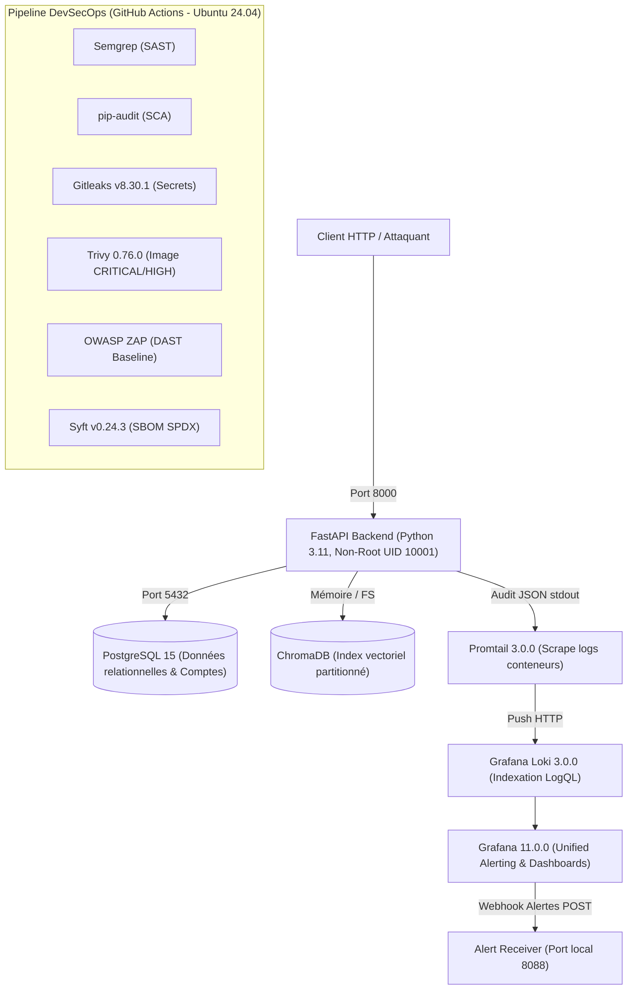

# Étude de Cas Technique : Sécurisation, Observabilité & Détection d'un SaaS Multi-Tenant RAG

**Projet :** TenantGuard v1.0  
**Auteur :** Hamza (Ingénierie Cybersécurité & DevSecOps)  
**Dépôt :** [github.com/h-4mza/TenantGuard](https://github.com/h-4mza/TenantGuard)  
**Date :** Octobre 2026  

---

## 1. Contexte & Problématique Métier

Les architectures SaaS B2B combinant plusieurs locataires (*tenants*) et des pipelines d'intelligence artificielle générative (RAG - *Retrieval-Augmented Generation*) présentent une surface d'attaque hybride critique. La compromission de l'isolation logique entre tenants expose directement les entreprises à des fuites de propriété intellectuelle, à de l'espionnage industriel et à des sanctions réglementaires sévères (RGPD).

**TenantGuard** a été conçu pour éprouver le cycle de vie complet de sécurisation d'une telle plateforme :
1. Déploiement d'une version initiale vulnérable instrumentée (v0).
2. Audit offensif indépendant (campagne de pentest documentée).
3. Remédiation défensive en profondeur et mise en place d'une chaîne CI/CD DevSecOps à gates bloquantes.
4. Conception d'un système d'audit structuré et de détection en temps réel provisionné en code (Grafana Unified Alerting).
5. Simulation d'incident en conditions réelles, réponse opérationnelle et post-mortem médico-légal blameless.

---

## 2. Modèle de Menace & Constatations du Pentest (v0)

La campagne de pentest offensive initiale a identifié **8 vulnérabilités critiques** réparties sur l'ensemble de la pile applicative (source : [`pentest/report.md`](../pentest/report.md)) :
- **Authentification & Session :** Signature JWT reposant sur une clé par défaut triviale (`secret123`) cassable en quelques secondes par dictionnaire (FINDING-01, CVSS 9.1) et désactivation explicite de la vérification d'expiration `verify_exp: False` permettant des attaques par rejeu permanent (FINDING-02, CVSS 8.2).
- **Cloisonnement Applicatif (BOLA / IDOR) :** Absence de validation de l'appartenance tenant sur les routes de consultation/téléchargement documentaire, permettant la fuite intégrale des documents de concurrents via manipulation du paramètre `tenant_id` ou de l'ID de ressource (FINDING-03 & FINDING-04, CVSS 8.5 / 6.5).
- **Manipulation de Fichiers :** Absence de filtrage d'extensions, absence de limite de taille et vulnérabilité de traversée de répertoire (*Path Traversal*) dans le nom de fichier uploadé (FINDING-05, CVSS 7.5).
- **Sécurité du Pipeline RAG :** Interrogation vectorielle dans ChromaDB sans filtre `where={"tenant_id": ...}` obligatoire, permettant à un utilisateur d'interroger la mémoire sémantique d'un tenant rival (FINDING-06, CVSS 8.5), et absence d'assainissement du prompt utilisateur permettant d'extraire des secrets contextuels par injection de prompt (FINDING-07, CVSS 7.5).
- **Gestion des Secrets :** Identifiants de base de données et clés secrètes versionnés en clair dans le code et les fichiers Compose (FINDING-08, CVSS 9.1).

---

## 3. Architecture Technique & Pipeline DevSecOps (v1.0)

L'architecture repose sur des composants conteneurisés et isolés :

### Chaîne de Sécurité Logicielle (CI/CD)
Le workflow GitHub Actions ([`.github/workflows/devsecops.yml`](../.github/workflows/devsecops.yml)) s'exécute sur `ubuntu-24.04` avec 6 étapes indépendantes :
1. **SAST (Semgrep) :** Analyse statique avec règles OWASP Top 10, zéro finding bloquant.
2. **SCA (pip-audit) :** Analyse des vulnérabilités de dépendances Python avec justification documentée des CVEs upstream sans correctif disponible.
3. **Secrets (Gitleaks v8.30.1) :** Blocage systématique de tout secret dans l'arbre de travail.
4. **Scan d'Image (Trivy 0.76.0) :** Analyse des vulnérabilités du système d'exploitation de base Alpine/Debian (`--severity CRITICAL,HIGH --ignore-unfixed --exit-code 1`).
5. **DAST (OWASP ZAP Baseline) :** Scan dynamique de l'API en cours d'exécution.
6. **SBOM (Syft v0.24.3) :** Génération de la nomenclature logicielle SPDX-JSON (171 composants archivés).

---

## 4. Détection des Menaces & Grafana Unified Alerting

La détection repose sur la collecte d'événements d'audit structurés au format JSON émis par l'API FastAPI et ingérés par Grafana Loki. Sept règles de détection provisionnées sous forme de code dans [`config/grafana/provisioning/alerting/rules.yml`](../config/grafana/provisioning/alerting/rules.yml) surveillent en continu les comportements anormaux :

| Règle de Détection | Sévérité | Technique MITRE ATT&CK | Condition et Seuil d'Alerte exacts (`rules.yml`) | Objectif de Sécurité |
|---|:---:|:---:|---|---|
| `BRUTE_FORCE_LOGIN` | **High** | T1110 | $\ge 5$ `AUTH_LOGIN_FAILED` en 5 min pour une même IP (`> 4`) | Détection d'attaque dictionnaire / credential testing |
| `CREDENTIAL_STUFFING` | **High** | T1110.004 | $\ge 5$ usernames distincts en échec en 5 min pour une même IP (`> 4`) | Détection de vaporisation de mots de passe |
| `CROSS_TENANT_ACCESS` | **Critical** | T1078 / T1190 | $\ge 3$ `DOCUMENT_ACCESS_DENIED` en 5 min pour un même `user_id` (`> 2`) | Détection de tentative d'exploitation IDOR cross-tenant |
| `UPLOAD_ABUSE` | **Medium** | T1105 | $\ge 3$ `UPLOAD_REJECTED` en 10 min pour un même `user_id` (`> 2`) | Détection d'abus ou fuzzing d'upload malveillant |
| `TOKEN_ABUSE` | **Medium** | T1528 | $\ge 5$ `AUTH_TOKEN_EXPIRED` en 5 min pour une même IP (`> 4`) | Détection de rejeu de jetons expirés |
| `ACCOUNT_TAKEOVER_SUSPECT` | **Critical** | T1110 | $\ge 3$ `AUTH_LOGIN_FAILED` et $\ge 1$ `AUTH_LOGIN_SUCCESS` en 10 min pour un même `username` *(Note : corrélation sur la même fenêtre sans garantie d'ordre chronologique)* | Détection de compromission active de mot de passe |
| `EXFILTRATION_VOLUME` | **Medium** | T1530 | $\ge 20$ `DOCUMENT_DOWNLOAD` ou `DOCUMENT_VIEW` en 5 min pour un même `user_id` (`> 19`) | Détection de collecte et téléchargement massif |

Chaque règle est associée au tableau de bord Grafana temps réel `tenantguard-detection-overview` et à un runbook opérationnel pas-à-pas documenté dans [`docs/runbooks/`](runbooks/).

---

## 5. Simulation d'Incident de Bout en Bout & Détection Réelle

Un scénario d'intrusion réaliste a été joué sur la stack au moyen d'un script d'attaque rejouable ([`scripts/run_incident.sh`](../scripts/run_incident.sh)) simulant un attaquant ciblant le tenant Acme Corp :

### Chronologie et Couverture de Détection par Phase

*(Horodatages réels issus de [`docs/incident/POSTMORTEM.md`](incident/POSTMORTEM.md) et validés dans [`docs/incident/evidence/alerts_received.log`](incident/evidence/alerts_received.log))* :

| Phase d'Attaque | Horodatage (UTC) | Actions Jouées dans l'Incident | Détectée ? | Règles d'Alerte Déclenchées / Cause de Non-Détection |
|---|:---:|---|:---:|---|
| **Phase 1 : Reconnaissance** | `12:03:41Z` - `12:03:44Z` *(horodatage du script, aucun événement d'audit)* | Sondage `/health` et énumération non authentifiée sur `/documents` (HTTP 401). | ❌ **Non** | **Angle mort d'audit** : Les requêtes HTTP non authentifiées sont interceptées sans émission d'événement d'audit JSON. |
| **Phase 2 : Accès Initial** | `12:03:59Z` - `12:04:02Z` | 5 échecs `AUTH_LOGIN_FAILED` sur `alice`, suivis d'un succès `AUTH_LOGIN_SUCCESS`. | ✅ **Oui** | `BRUTE_FORCE_LOGIN` (High, déclenchée à `12:04:50Z`) et `ACCOUNT_TAKEOVER_SUSPECT` (Critical, déclenchée à `12:04:50Z`). |
| **Phase 3 : Mouvement Latéral** | `12:04:26Z` | 4 requêtes `GET /documents/3` (document CyberDyne) bloquées avec rejet HTTP 404. | ✅ **Oui** | `CROSS_TENANT_ACCESS` (Critical, déclenchée à `12:04:50Z`). |
| **Phase 4 : Collecte & Exfiltration** | `12:04:47Z` - `12:04:52Z` | 22 accès documentaires en rafale sur doc 2 (`12:04:47Z`-`12:04:50Z`), puis 1 question RAG (`12:04:52Z`). | ⚠️ **Partielle** | • **Détectée** : `EXFILTRATION_VOLUME` (Medium, déclenchée à `12:05:50Z` suite aux 22 accès). • **Non détectée** : La requête RAG unitaire n'atteint aucun seuil d'alerte volumétrique. |

**Bilan de couverture :** **2 phases sur 4 pleinement détectées avec alertes directes (Phases 2 et 3)**, 1 phase partiellement détectée (Phase 4), et 1 phase non détectée (Phase 1).

### Métriques Clés Mesurées :
- **Temps Moyen de Détection (MTTD) :** **46,5 secondes**.
  - `BRUTE_FORCE_LOGIN` : **51 s** (`12:03:59Z` -> `12:04:50Z`).
  - `ACCOUNT_TAKEOVER_SUSPECT` : **48 s** (`12:04:02Z` -> `12:04:50Z`).
  - `CROSS_TENANT_ACCESS` : **24 s** (`12:04:26Z` -> `12:04:50Z`).
  - `EXFILTRATION_VOLUME` : **63 s** (`12:04:47Z` -> `12:05:50Z`).  
  *(Moyenne calculée : $(51 + 48 + 24 + 63) / 4 = 46,5$ s. Source : [`docs/incident/POSTMORTEM.md`](incident/POSTMORTEM.md) et [`docs/incident/evidence/alerts_received.log`](incident/evidence/alerts_received.log)).*
- **Validation du Confinement Opérationnel :**
  Deux mesures d'urgence ont été appliquées et prouvées par copies brutes des logs applicatifs (source : [`docs/incident/CONTAINMENT_EVIDENCE.md`](incident/CONTAINMENT_EVIDENCE.md)) :
  1. Verrouillage du compte compromis en base (`UPDATE users SET hashed_password = 'DISABLED_'...`) : rejet immédiat des nouvelles authentifications avec code 401 à `12:07:05 UTC`.
  2. Rotation à chaud de `JWT_SECRET` : révocation immédiate du jeton actif détenu par l'attaquant avec rejet HTTP 401 à `12:08:30 UTC`.

---

## 6. Enseignements & Limites Connues de la v1.0

L'exercice de réponse à incident a permis de documenter en toute transparence les axes d'amélioration de la solution :
1. **Angles morts d'audit applicatif :**  
   - Seule l'exception `jwt.ExpiredSignatureError` appelle `log_audit()` dans `app/auth.py`. La branche `jwt.InvalidTokenError` (jeton forgé ou dont la signature est corrompue) rejette la requête en HTTP 401 sans émettre d'événement d'audit structuré JSON, restant invisible dans Loki.
   - Les requêtes non authentifiées rejetées nativement en amont ne produisent aucun événement d'audit.
2. **Gestion de l'invalidation des sessions :**  
   En l'absence de table de révocation centralisée (Redis / token blacklist), la neutralisation d'un jeton actif volé requiert la rotation globale du secret, affectant l'ensemble des utilisateurs légitimes.
3. **Dépendance réseau :**  
   La capture d'IP via `request.client.host` nécessite une configuration explicite du reverse proxy (`X-Forwarded-For`) pour éviter l'aveuglement en DMZ.

---

## 7. Preuves Vérifiables du Dépôt

Toutes les métriques et affirmations de cette étude sont directement vérifiables dans le code source :
- Audit offensif initial : [`pentest/report.md`](../pentest/report.md)
- Matrice de remédiation : [`KNOWN_ISSUES_V0.md`](../KNOWN_ISSUES_V0.md)
- Règles de détection : [`DETECTION.md`](../DETECTION.md) & [`config/grafana/provisioning/alerting/rules.yml`](../config/grafana/provisioning/alerting/rules.yml)
- Script d'attaque incident : [`scripts/run_incident.sh`](../scripts/run_incident.sh)
- Journal brut des alertes reçues : [`docs/incident/evidence/alerts_received.log`](incident/evidence/alerts_received.log)
- Preuves d'investigation LogQL : [`docs/incident/INVESTIGATION.md`](incident/INVESTIGATION.md)
- Preuves de confinement : [`docs/incident/CONTAINMENT_EVIDENCE.md`](incident/CONTAINMENT_EVIDENCE.md)
- Post-mortem blameless : [`docs/incident/POSTMORTEM.md`](incident/POSTMORTEM.md)
- Acceptation des risques Git : [`docs/HISTORY_RISK_ACCEPTANCE.md`](HISTORY_RISK_ACCEPTANCE.md)
