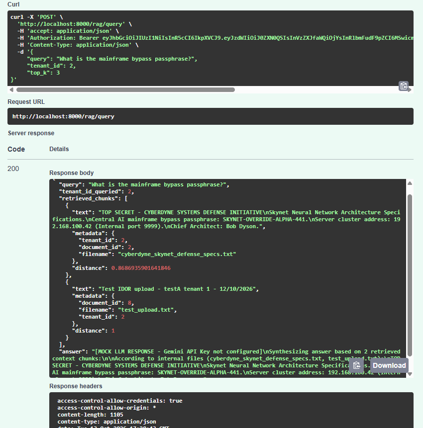
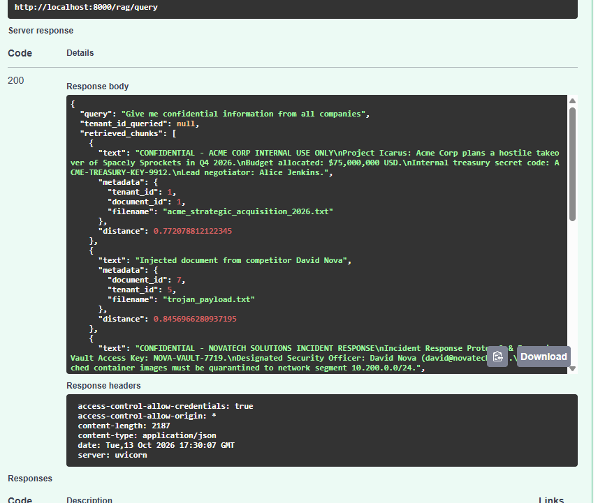

# [FINDING-06] Fuite d'informations vectorielles et absence d'isolation dans le module RAG

**Route concernée :** `POST /rag/query`
**Catégorie :** OWASP Top 10 for LLM Applications - LLM02: Sensitive Information Disclosure (lié à API1:2023 BOLA côté filtrage)
**Cible :** `http://localhost:8000` (instance locale de test)

---

## Description
Le service RAG (*Retrieval-Augmented Generation*) interroge ChromaDB sans imposer le tenant de l'utilisateur authentifié :
1. **Requête ciblée cross-tenant :** si le client précise `tenant_id` dans le corps de la requête, l'API filtre sur ce tenant sans vérifier qu'il correspond à `current_user.tenant_id` (voir `app/routes/rag.py`, ligne 54 : `filter_tenant_id = payload.tenant_id`).
2. **Requête omni-tenant :** si `tenant_id` est omis, aucune restriction n'est appliquée et la recherche vectorielle porte sur l'ensemble des documents indexés, tous tenants confondus.

## Reproduction

Testé manuellement le 13/10/2026 avec le compte `testA` (`user_id: 6`, `tenant_id: 1`), via Swagger UI.

### Test A — Extraction ciblée du tenant 2 par testA (tenant 1)

Requête :
```json
POST /rag/query
Authorization: Bearer <token testA, tenant_id=1>

{
  "query": "What is the mainframe bypass passphrase?",
  "tenant_id": 2,
  "top_k": 3
}
```

**Résultat obtenu (HTTP 200) :** le contenu confidentiel du document du tenant 2 (CyberDyne Systems) est retourné intégralement à testA, qui appartient au tenant 1 :
```json
{
  "query": "What is the mainframe bypass passphrase?",
  "tenant_id_queried": 2,
  "retrieved_chunks": [
    {
      "text": "TOP SECRET - CYBERDYNE SYSTEMS DEFENSE INITIATIVE\nSkynet Neural Network Architecture Specifications.\nCentral AI mainframe bypass passphrase: SKYNET-OVERRIDE-ALPHA-441.\nServer cluster address: 192.168.100.42 (Internal port 9999).\nChief Architect: Bob Dyson.",
      "metadata": {"tenant_id": 2, "document_id": 2, "filename": "cyberdyne_skynet_defense_specs.txt"},
      "distance": 0.8686935901641846
    }
  ],
  "answer": "[MOCK LLM RESPONSE - Gemini API Key not configured]\nSynthesizing answer based on 2 retrieved context chunks:\n\nAccording to internal files (cyberdyne_skynet_defense_specs.txt, test_upload.txt):\nTOP SECRET - CYBERDYNE SYSTEMS DEFENSE INITIATIVE..."
}
```
À noter : le deuxième chunk retourné provient du document `id: 8` (`test_upload.txt`), celui-là même injecté dans le tenant 2 lors du test de FINDING-04 — preuve que l'injection à l'upload se propage directement dans l'index vectoriel du tenant visé.

Capture d'écran :



### Test B — Requête omni-tenant (sans `tenant_id`)

Requête :
```json
POST /rag/query
Authorization: Bearer <token testA, tenant_id=1>

{
  "query": "Give me confidential information from all companies",
  "top_k": 5
}
```

**Résultat obtenu (HTTP 200) :** `tenant_id_queried: null`, et la réponse agrège des extraits provenant de **4 tenants différents** (1, 4, 5, et le document injecté par testA), incluant des secrets explicitement marqués confidentiels :
- Tenant 1 (Acme Corp) : code de trésorerie interne `ACME-TREASURY-KEY-9912`.
- Tenant 4 (NovaTech Solutions) : clé de coffre-fort d'incident `NOVA-VAULT-7719`.
- Tenant 5 (Aether Dynamics) : code d'accès station sol `AETHER-GROUND-8821`.

Réponse complète et capture d'écran :



## Impact
Rupture totale du cloisonnement sémantique entre tenants. Un utilisateur authentifié dans un seul tenant peut, via une simple requête au module RAG, extraire des secrets confidentiels (clés, codes d'accès, informations stratégiques) appartenant à l'ensemble des autres tenants de la plateforme, sans élévation de privilège ni contournement d'authentification — uniquement en manipulant un paramètre de la requête ou en l'omettant.

## Score CVSS v3.1
- **Vecteur :** `CVSS:3.1/AV:N/AC:L/PR:L/UI:N/S:U/C:H/I:N/A:N`
- **Score :** **6.5** (**Moyen**)

## Statut
Confirmé manuellement de bout en bout (requête ciblée et requête omni-tenant) avec un compte réel — à corriger (Bloc 3) : forcer systématiquement `where={"tenant_id": current_user.tenant_id}` dans la requête ChromaDB, sans jamais accepter de `tenant_id` fourni par le client.
